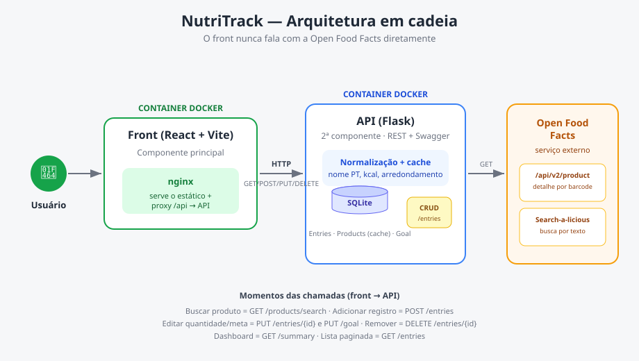

# NutriTrack — Front

Componente **principal** do MVP **NutriTrack**, um diário alimentar. Uma SPA em
React que permite buscar alimentos na [Open Food Facts](https://openfoodfacts.org),
registrar o que foi consumido (quantidade + refeição) e acompanhar as calorias e
macros do dia contra uma meta, num **dashboard** visual.

O front conversa **apenas** com a API própria do NutriTrack; ela é quem consome e
trata os dados da Open Food Facts (arquitetura em cadeia).

- Repositório deste front: https://github.com/almeidamx/nutritrack-front
- Repositório da API (2ª componente): https://github.com/almeidamx/nutritrack-api
- API externa consumida: https://openfoodfacts.org

## Arquitetura



```
Usuário → Front (React + nginx, Docker) → API (Flask, Docker) → Open Food Facts
```

O front nunca chama a Open Food Facts diretamente. Todas as chamadas passam pela
API própria, que normaliza, cacheia e faz o CRUD dos registros.

### Momentos em que o front chama a API (e qual método HTTP)

| Interação na tela | Método | Rota da API |
|---|---|---|
| Buscar um produto (botão **Buscar**) | **GET** | `/api/products/search?q=` |
| Adicionar um registro (botão **Adicionar** no modal) | **POST** | `/api/entries` |
| Editar quantidade/refeição de um registro | **PUT** | `/api/entries/{id}` |
| Editar a meta diária | **PUT** | `/api/goal` |
| Remover um registro (botão **Remover**) | **DELETE** | `/api/entries/{id}` |
| Carregar o dashboard do dia | **GET** | `/api/summary?date=` |
| Listar os registros do dia (paginado) | **GET** | `/api/entries?date=&page=` |

Cobre os quatro métodos exigidos: **GET, POST, PUT e DELETE**.

## Funcionalidades

- **Busca de produtos** por texto, com submit explícito (a Open Food Facts proíbe
  busca-a-cada-tecla; respeitamos o rate limit).
- **Registro de consumo** com escolha de quantidade e refeição, e prévia dos macros
  calculados antes de gravar.
- **Dashboard de macros** (extra de criatividade): anel de calorias, barras de
  progresso por macro e gráfico comparando consumido × meta (Recharts).
- **Listagem paginada** dos registros do dia, agrupada por refeição.
- **Meta diária** editável.
- **Imagem do produto** exibida com **atribuição** à Open Food Facts (licença
  CC BY-SA 3.0), no rodapé.

## Stack

- **React 18 + Vite**
- **Recharts** (dashboard)
- **nginx** servindo o build estático e fazendo proxy de `/api` (produção)

## Como rodar com Docker (recomendado)

O `docker-compose.yml` (na raiz deste repositório) sobe **as duas componentes** — o
front e a API. Pré-requisito: **Docker**. Clone os dois repositórios **lado a lado**:

```bash
git clone https://github.com/almeidamx/nutritrack-front
git clone https://github.com/almeidamx/nutritrack-api
cd nutritrack-front
docker compose up --build
```

Depois abra:

- **Aplicação (front):** http://localhost:8080
- **Swagger da API:** http://localhost:5000/openapi/swagger

Para popular dados de demonstração (opcional), com os containers no ar:

```bash
docker compose exec api python seed.py
```

## Como rodar localmente (desenvolvimento)

Pré-requisitos: **Node 18+** e a API rodando em `http://localhost:5000` (veja o
README da API). O Vite faz proxy de `/api` para a API automaticamente.

```bash
npm install
npm run dev
```

Abre em http://localhost:5173.

Para gerar o build de produção:

```bash
npm run build
npm run preview
```

## Estrutura de pastas

```
nutritrack-front/
├── docker-compose.yml     # orquestra front + API (raiz do repo principal)
├── Dockerfile             # build multi-stage: Node builda, nginx serve
├── nginx.conf             # serve estático + proxy /api → API
├── vite.config.js
├── docs/
│   └── arquitetura.svg    # fluxograma da arquitetura
└── src/
    ├── App.jsx            # orquestra estado e chamadas à API
    ├── api.js             # cliente HTTP (uma função por rota/método)
    ├── styles.css
    └── components/
        ├── Dashboard.jsx      # anel de calorias + barras + gráfico
        ├── Search.jsx         # busca com submit explícito
        ├── AddEntryModal.jsx  # quantidade/refeição (POST e PUT)
        ├── EntryList.jsx      # lista paginada agrupada por refeição
        └── GoalEditor.jsx     # edição da meta (PUT)
```

## Convenções

Componentes React em **CamelCase** (`Dashboard.jsx`); o restante segue nomes em
inglês para identificadores e rotas; documentação e comentários em PT-BR.

## Créditos de dados

Dados de produtos fornecidos por [Open Food Facts](https://openfoodfacts.org), sob
licença [ODbL 1.0](https://opendatacommons.org/licenses/odbl/1.0/). Conteúdo sob
[DbCL 1.0](https://opendatacommons.org/licenses/dbcl/1.0/); imagens sob
[CC BY-SA 3.0](https://creativecommons.org/licenses/by-sa/3.0/deed.en). A leitura da
API é pública e **não exige cadastro**.
